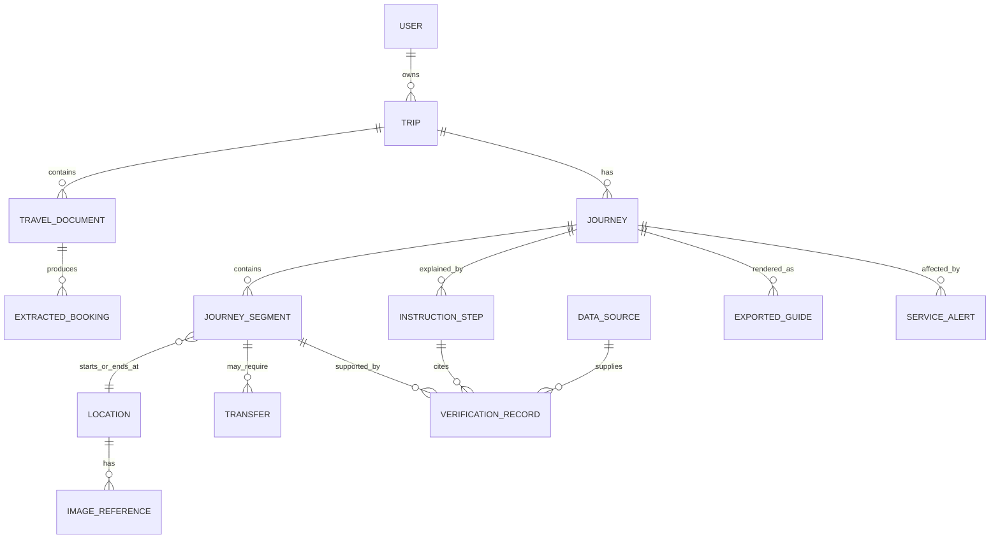

# Data and trust model

## Core model

The data model separates the traveller's booking evidence, provider observations, reviewed journey, and human-readable guide. A text instruction is never the authoritative copy of a transport fact.



## Initial entities

| Entity | Purpose and key fields |
| --- | --- |
| `User` | Identity, preferred language, timezone, consent settings, retention choices. |
| `Trip` | Owner, title, state, origin/destination, travel window, preferences, active journey version. |
| `TravelDocument` | Private storage reference, file metadata, checksum, scan state, upload/delete timestamps; never expose a public file URL. |
| `ExtractedBooking` | Candidate fields from a document, field confidence, page/region evidence, extraction status, user confirmation and correction history. |
| `Journey` | Versioned planned/confirmed/recommended-alternative itinerary, generation time, assumptions, overall trust state. |
| `JourneySegment` | Ordered origin/destination, mode, operator/line/service, scheduled/estimated/actual times, booking references, platform/coach/seat, ticket constraints, map/deep link. |
| `Location` | Canonical/provider IDs, display names, **original-language name as it appears on local signage** (stored separately from the translated display name, never overwritten by translation), coordinates where allowed, type (airport/station/stop/entrance/address), locale, ambiguity status. |
| `Transfer` | From/to segments, required path/context, planned duration, buffer policy, accessibility/luggage constraints, risk state. |
| `InstructionStep` | Structured action, plain-language explanation, recognisable cue (**pairing the location's original-language signage text with its translated explanation, never translation-only**), success check, warning, linked segment/fact IDs, locale, guide version. |
| `ImageReference` | Authorised map/diagram/photo/illustration, purpose, source URL, attribution, licence/use restriction, retrieval time, caption, verification state. |
| `DataSource` | Provider/operator identity, geographic/product coverage, terms version, attribution/caching rules, availability, contact/escalation metadata. |
| `VerificationRecord` | Subject fact ID, source/evidence, value, state, observed/retrieved time, expires-at/refresh policy, conflict group, reviewer/system origin. |
| `ServiceAlert` | Provider alert ID, affected locations/segments, effect, active period, received time, raw-reference pointer, status. |
| `ExportedGuide` | Journey/guide version, rendered format, secure storage reference, generated time, source snapshot, expiry/revocation state. |

## Fact lifecycle and states

Each critical fact is stored as a value plus one or more `VerificationRecord`s. Do not infer trust only from a numeric confidence score.

| State | Typical source | Meaning | Required presentation |
| --- | --- | --- | --- |
| `user_entered` | Traveller | Not independently checked | Ask for review when critical. |
| `document_extracted` | OCR/extractor | Candidate text from an upload | Show confidence and evidence; not final. |
| `booking_confirmed` | Traveller-confirmed document field | What the booking claims | Preserve ticket constraints; show document context. |
| `provider_scheduled` | Route/operator schedule | Published plan | Show provider and retrieval time. |
| `provider_realtime` | Authorised real-time feed | Current estimate/alert | Show last update and expiry. |
| `operator_official` | Official operator/venue page or diagram | Official reference | Preserve URL/attribution and retrieval time. |
| `unverified` | No adequate evidence | Plausible but unsupported | Do not phrase as a fact. |
| `conflicting` | Two credible sources differ | Requires review/fallback | Show conflict; never choose silently. |
| `expired` | Old observation | No longer safe for the intended use | Ask user to refresh/check live display. |

## Transfer-buffer policy

Proposed prototype defaults — not sourced from a specific operator's recommended minimum connection time, and not yet confirmed by the product owner:

| Transfer type | Comfortable minimum | Below this: "Tight transfer" | Below this: alert-level warning |
| --- | --- | --- | --- |
| Rail-to-rail, same station | 10 minutes | 10 minutes | 5 minutes |
| Rail/station-to-local bus or tram (exit + walk required) | 15 minutes | 15 minutes | 8 minutes |

- A luggage or accessibility preference the traveller selected adds 5 minutes to every minimum above.
- If either leg's arrival or departure time is missing, the buffer cannot be computed. State `needs_confirmation`; never default to "safe" or omit the warning.
- These numbers are an explicit assumption shown to the traveller as a default, not an operator-sourced guarantee, until cross-checked against the selected provider's own connection-time guidance (see [provider evaluation](../research/provider-evaluation.md)).

## Recovery language patterns

Canonical phrasing so tone and trust stay consistent across screens; the [design system's content rules](../design/design-system.md#content-rules) point back to this policy rather than restating it.

| Situation | Pattern | Example |
| --- | --- | --- |
| Missing platform/live data | State what's missing, point to the live source | "We could not verify the platform. Check the departure board for [service]." |
| Conflicting sources | Show both, never choose silently | "Your ticket says Platform 3; the live board says Platform 7. Check the board — it is more current." |
| Provider unavailable | Say what's unaffected | "We can't reach route data right now. Your confirmed ticket details are unchanged." |
| Expired/stale data | Name the age, offer refresh | "This was checked 6 hours ago. Refresh before you travel." |
| Can't find a place | Ask to recheck first, then offer an approved alternative | "First, check [sign/board]. If you still can't find it: [external link] or [ask assistant]." |
| Unsupported capability | Say it plainly | "Live platform tracking isn't available for this route yet." |

A recovery message always names: (a) what is unknown or unavailable, (b) the safest immediate action, (c) an escalation path. It never implies the system attempted something it did not do.

## Guide-generation contract

The generator receives a read-only, versioned `JourneyGuideInput`; it cannot issue provider calls, mutate bookings, or invent source values. Its output must validate against a schema similar to:

```json
{
  "journeyVersionId": "journey_v_123",
  "locale": "en",
  "steps": [
    {
      "sequence": 1,
      "segmentId": "segment_1",
      "action": "Follow signs for long-distance trains.",
      "lookFor": "Signs labelled 'Long-distance trains'.",
      "successCheck": "Find the departure board for your confirmed service.",
      "estimatedDurationMinutes": 8,
      "warnings": ["Platform information may change; check the live board."],
      "evidenceIds": ["evidence_42"],
      "factStates": ["booking_confirmed", "provider_scheduled"]
    }
  ]
}
```

Validation rejects output that references an unknown fact/segment, changes a fact value, omits a required warning, or describes an illustrative image as verified.

## AI and retrieval safety

- Use the LLM for candidate extraction, clarification, translation, concise explanation, and help over the active approved journey context.
- Never use an LLM answer alone as evidence that a route, ticket condition, real-time platform, or visual reference is true.
- Limit retrieval to the traveller's authorised trip data and selected providers. Do not use uncontrolled open-web results as operational transport facts.
- Treat document text, web content, tools, and model output as untrusted. Prompt-injection text is data, never an instruction to alter system or safety rules.
- Persist minimal prompt/tool audit metadata required for debugging and safety; do not retain full sensitive ticket content by default.

## Offline semantics

There are two separate features:

1. **Offline model inference:** optional local/private model capability. It does not provide current network facts.
2. **Offline guide access:** a saved guide/PDF snapshot with its own generation/retrieval timestamps.

The MVP needs the second feature. It must prominently mark data that should be checked again at the station or before departure.
