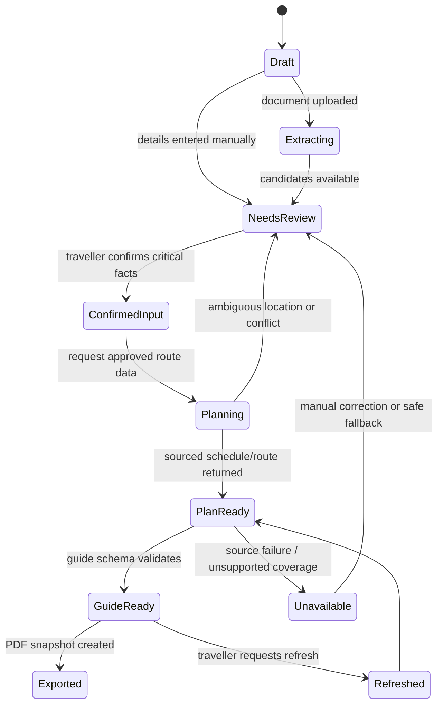

# Preliminary architecture — Frankfurt Airport to Boxberg prototype

## Prototype purpose

Prove one complete, safe workflow:

```text
arrival details + optional ticket upload
→ traveller review of extracted facts
→ scheduled journey plan / clearly labelled route recommendation
→ visual, step-by-step guide
→ source-labelled offline PDF snapshot
```

This is not a commitment to an API vendor, a production stack, or real-time monitoring.

## Required trip input contract

| Input | Required? | Why |
| --- | --- | --- |
| Arrival location | Yes | Resolves the airport/terminal starting context. Default search result may be Frankfurt Airport, but terminal/arrival context is still useful. |
| Arrival date and local time | Yes | A route is meaningless without a time; stored with timezone. |
| Precise accommodation address or pin | Yes | Required to plan the Boxberg local connection and final walk. |
| Traveller preferences | Optional | Luggage, fewer transfers, walking tolerance, accessibility needs. Explicitly state when a source cannot honour a preference. |
| Flight/train/bus ticket | Optional | Supplies booking evidence when the traveller has an existing itinerary. |
| Intermediate reservation | Optional | Adds service/coach/seat/ticket constraints. It is not required for route suggestions. |

## Journey state machine



## Pilot-specific route rules

1. The traveller's confirmed intermediate ticket outranks a route suggestion for the matching leg.
2. When no intermediate rail/bus ticket exists, route options are marked **recommended**, include provider/retrieval time, and require explicit selection before they become the working plan.
3. A platform, rail service, local bus line, stop, or accommodation entrance is displayed only if supported by the approved booking/provider/official source. Otherwise the guide tells the traveller what to check and where.
4. The Fraport → Fernbahnhof connection is a wayfinding step with source-specific evidence. The system must not assume a terminal, walking time, or indoor path without such evidence.
5. The Heidelberg Hbf → Boxberg local leg is provider-derived. The prototype must support “no verified local connection available” as a first-class result.
6. The PDF embeds the guide snapshot and permitted assets only. It never presents the snapshot as live service information.

## Component responsibilities

| Component | Pilot responsibility | Must not do |
| --- | --- | --- |
| Web/PWA client | Collect inputs, render review/guide/PDF status, cache an approved guide snapshot | Hold provider secrets or treat UI state as authorisation. |
| Trip API | Authorise access, version trips, orchestrate review/planning/generation | Call unknown providers directly from customer text. |
| Private document service | Validate/scan/store upload, issue scoped access, delete on request | Expose a public ticket URL or store raw documents in logs. |
| Extraction adapter | Produce field candidates with page/region evidence | Create confirmed bookings without user review. |
| Route/location adapters | Request selected provider data and normalise it | Replace a booked service or conceal coverage gaps. |
| Evidence service | Attach source, timestamp, status, expiry, conflict/review state | Convert confidence into a false verification guarantee. |
| Guide generator | Turn approved journey facts into structured English steps | Add unverified operational claims or choose a route. |
| Reference curator | Return an authorised official map/diagram/photo or no visual | Scrape search/map imagery or mislabel illustrations. |
| PDF renderer | Render a specific journey/guide version with source labels | Embed provider content without checking export/attribution rights. |

## Data minimisation and retention design

- Keep raw ticket files separate from extracted trip facts.
- A traveller can delete an uploaded document, an exported guide, or the entire trip from the trip settings; deletion must remove inaccessible copies from active storage and schedule backup expiry according to the selected platform policy.
- Use simulated or de-identified documents for the private prototype until a real-document consent notice, storage region, retention period, and deletion limitations are approved.
- Do not enable continuous location tracking for this prototype. External map links may receive location according to their own user interaction and privacy terms.
- The final retention period is intentionally not invented. It is an open product/legal decision; the interface must state the selected duration before upload.

## Recommended prototype boundary

Build a thin vertical slice after provider approval:

1. Text-based/manual details plus one simulated PDF/image ticket.
2. Review screen that demonstrates correction, ambiguity, and an unbooked recommendation.
3. A provider adapter returning a controlled Frankfurt-to-Heidelberg-to-Boxberg scenario from approved data/fixtures.
4. One official/authorised Fernbahnhof reference and external map links.
5. English structured guide, current-step view, and one PDF snapshot.
6. Explicit unavailable/stale/no-live-data recovery screens.

Do not start with a generic agent that searches the web for travel answers. The structured journey and evidence pipeline is the product core.
