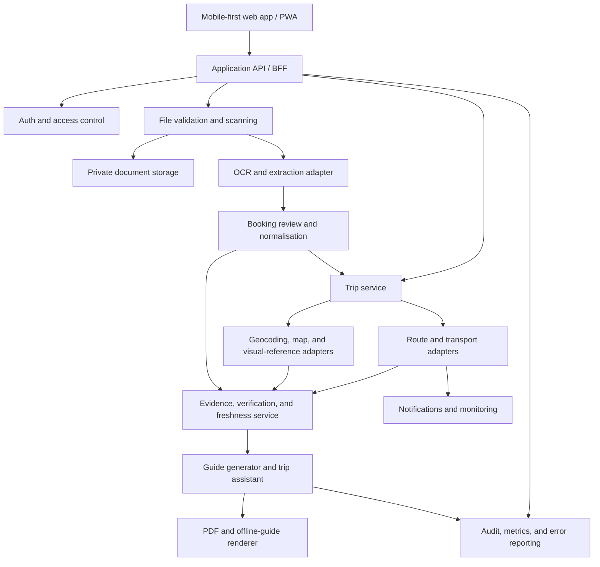
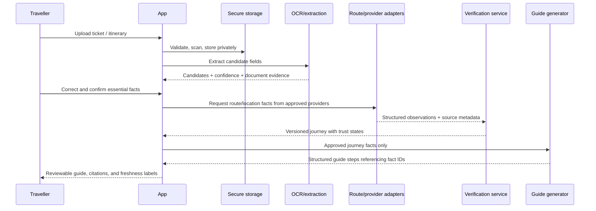

# Architecture overview

## Design thesis

The system should be **provider-adaptable and evidence-first**. Structured journey facts and their provenance form the product's source of truth. OCR, route engines, live feeds, images, and LLMs contribute evidence or explanations but cannot overwrite confirmed facts without a visible review/version change.

This is a preliminary architecture, not a stack decision. Technology choices follow the provider and privacy gates in the roadmap.

The current pilot-specific vertical slice is documented in [Frankfurt pilot architecture](frankfurt-pilot.md). It adds no operational facts beyond the user-confirmed inputs and approved provider responses.

## Logical components

## Key boundaries

| Boundary | Rule |
| --- | --- |
| Client ↔ application | The client may display and request actions; it never has provider secrets or authority to execute privileged operations. |
| Documents ↔ extraction | Uploads are untrusted. Validate file type/size, malware-scan where available, store privately, and use a queued extraction job. |
| Extraction ↔ booking facts | Extraction creates candidates with evidence and confidence. The traveller confirms essential facts before planning. |
| Provider adapters ↔ journey model | Convert provider-specific responses into typed internal interfaces; retain raw reference metadata needed for audit, not arbitrary provider data. |
| Journey model ↔ LLM | Give the LLM a versioned, minimal, typed set of approved facts. Validate its structured output before rendering. |
| Live feeds ↔ saved guide | A live update creates a new observation/version; it never mutates a downloaded guide silently. |

## Document-to-guide flow

## Provider interfaces to preserve replaceability

Implement only after providers are selected, but design around interfaces similar to these:

- `DocumentExtractionProvider.extract(document)` → candidates, page/field evidence, confidence, language.
- `LocationProvider.resolve(query)` → canonical provider ID, coordinates, address/display name, ambiguity candidates.
- `RouteProvider.plan(request)` → itinerary candidates, segments, schedules, constraints, source metadata.
- `RealtimeProvider.observe(segments)` → trip updates, service alerts, freshness, provider coverage.
- `VisualReferenceProvider.find(location, intent)` → authorised image/diagram/map reference, licence, attribution, expiry/caching rules.
- `GuideGenerator.generate(journeyVersion, locale)` → schema-conformant explanation referencing existing fact IDs only.
- `ExportRenderer.render(guideVersion)` → immutable PDF/snapshot with its source and generation metadata.

No adapter may hide a provider's licence, geographic coverage, response timestamp, confidence caveat, or fallback behaviour.

## Non-negotiable reliability controls

1. **Versioned journey snapshots.** A guide and PDF reference a specific journey version and source observations.
2. **Evidence links.** Critical instructions point to evidence rather than a free-text model claim.
3. **Freshness policy.** Each data class has an explicit usable-until/refresh rule; stale information is visible, not silently reused.
4. **Conflict policy.** Conflicting source values create a conflict state, user prompt, or safe fallback—not arbitrary model selection.
5. **Provider failure policy.** Preserve confirmed booking facts, explain unavailable data, and offer the next safe user action.
6. **Auditability.** Record provider, timestamp, request version, result status, and fact lineage without logging unnecessary ticket content or secrets.

## Security and privacy baseline

- Authenticate every user-facing request and authorise every trip, document, generated guide, and export by owner/organisation.
- Store uploaded files and generated exports privately with short-lived, scoped access URLs.
- Encrypt data in transit and use storage/database controls appropriate to the selected platform.
- Retain only the personal data needed to build the guide; define deletion, retention, backup, and access-log behaviour before public launch.
- Require explicit, revocable consent for location tracking and notifications. Do not collect continuous location for the MVP.
- Isolate API keys in server-side secret management and use least-privilege provider credentials.

## Deferred decisions

- Frontend/backend framework, hosting, database, queue, identity provider, OCR vendor, LLM vendor, map/route source, notification channel, and PDF renderer.
- These choices must be evaluated against the launch corridor and the legal/commercial requirements in [provider evaluation](../research/provider-evaluation.md).
