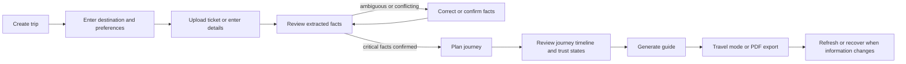

# Experience specification

## Information architecture

```text
My Trips
├── Create / import trip
├── Upcoming trip card
└── Trip workspace
    ├── Setup and preferences
    ├── Document review
    ├── Journey overview
    ├── Step-by-step travel mode
    ├── Trip assistant
    ├── PDF preview / export
    └── Settings, privacy, and refresh history
```

## Primary flow



### Frankfurt pilot input sequence

1. Ask for Frankfurt Airport arrival context and local arrival date/time.
2. Ask for a precise Boxberg accommodation address or map pin; show that “Boxberg, Heidelberg” alone is insufficient for a final-walk guide.
3. Offer optional ticket/itinerary upload. Explain that the traveller can continue without intermediate tickets and receive a recommendation rather than a booked plan.
4. Require review of extracted/entered facts before route planning.
5. Present the journey as Airport → Fernbahnhof → Heidelberg Hbf → provider-derived local connection → final walk, with each leg's own source state.
6. Make the current step, not a general chat input, the primary travel-mode surface.

## Screen inventory

| Screen | User outcome | Essential states |
| --- | --- | --- |
| My Trips | Start or reopen a journey | Empty, upcoming, expired, loading, deletion confirmation |
| Trip setup | Supply location, time, and constraints | Missing address, ambiguous location, accessibility/luggage preference |
| Upload | Add an itinerary safely | Type/size rejection, scanning, processing, retry, manual fallback |
| Document review | Confirm extracted booking facts | High/low confidence, conflict, unknown, corrected, confirmed |
| Journey overview | Assess the whole plan | Scheduled/live/unverified status, tight transfer, source unavailable, alternate route |
| Travel mode | Complete the next real-world action | Current/complete/return, offline snapshot, lost, live data stale |
| Map/reference | Recognise a location or hand off navigation | Attributed map, source unavailable, illustration label, external-app handoff |
| Trip assistant | Ask about the active trip | Sourced answer, clarification, unsupported/unavailable fact, escalation guidance |
| PDF preview/export | Save/share a reviewed guide | Generation, success, failure, stale-data warning |
| Settings | Control language, privacy, retention, and notifications | Permission denied, download/delete data, notification opt-in |

## Travel-mode step contract

The current-step view puts one primary action above the fold. It must answer:

1. **Where am I now?** A named, sourced starting point.
2. **What do I do now?** One short imperative action.
3. **What should I look for?** An exact sign, vehicle name/number, official diagram, or carefully labelled landmark when available.
4. **How do I know it worked?** A check such as the stop name, train number, or platform shown on an official board.
5. **What comes next?** A short preview of the following step.
6. **What if this fails?** A visible “I cannot find this” path that first asks the traveller to recheck a board/sign/source, then offers an approved recovery route or escalation.

## Trust and freshness language

Use both an icon/text label and plain-language explanation. Never collapse these states into a single green “verified” badge.

| State | Meaning | UI treatment |
| --- | --- | --- |
| Booking confirmed | Extracted from an uploaded document and confirmed by the traveller | Ticket icon; show confirmation date and document source |
| Scheduled | Published timetable/route information | Calendar icon; show provider and retrieved time |
| Live estimate | Real-time provider update | Pulse icon; show provider and last refresh time |
| Needs confirmation | Missing, ambiguous, or unverified fact | Warning icon; explain exactly what the traveller must check |
| Conflicting | Credible sources disagree | Warning icon; show both sources and do not choose silently |
| Expired | Previously retrieved data is too old for its use | Muted warning; offer refresh or safe fallback |

## Design rules

- Design mobile-first for a tired traveller using one hand, in poor connectivity, possibly carrying luggage.
- Use large type, high contrast, predictable language, and a single primary action per step.
- Make time zone, date, language, source, and last-check time explicit where they matter.
- Do not rely on colour, a map, a hover state, or network availability alone to communicate a necessary action.
- External map links complement the guide; they do not remove the product’s responsibility to explain the next action.
- Mark demonstration data, generated imagery, and unavailable live information unambiguously.

## Accessibility and offline requirements

- Meet WCAG 2.2 AA where practical; validate keyboard, screen-reader, zoom, contrast, and reduced-motion behaviour.
- Offer text alternatives for maps and images that carry navigational meaning.
- Keep the currently downloaded guide, ticket summary required for travel, and emergency/recovery instructions accessible without a connection.
- Do not cache sensitive documents or live content beyond the approved retention and provider-licence policy.
